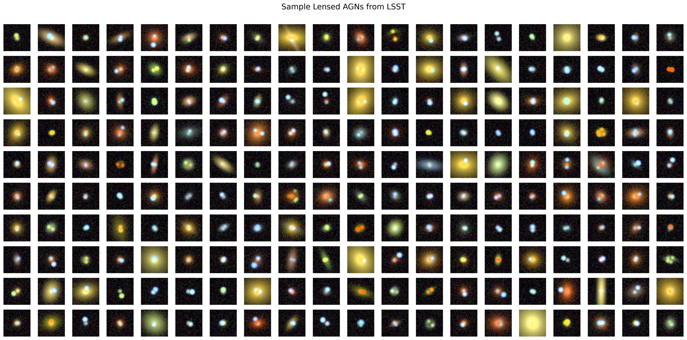
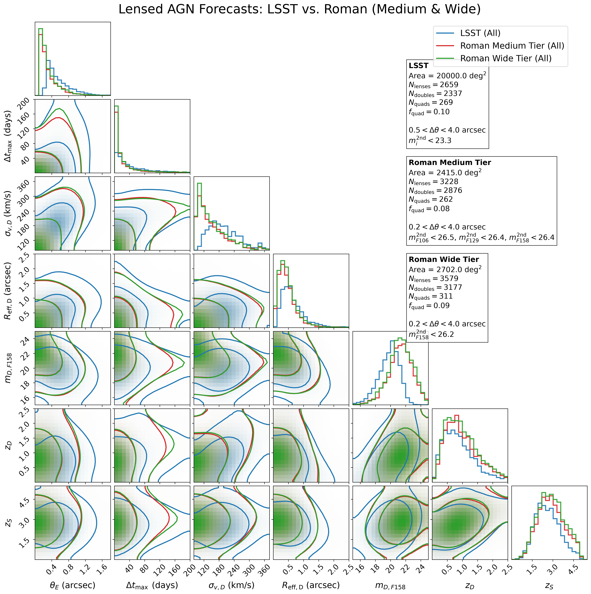
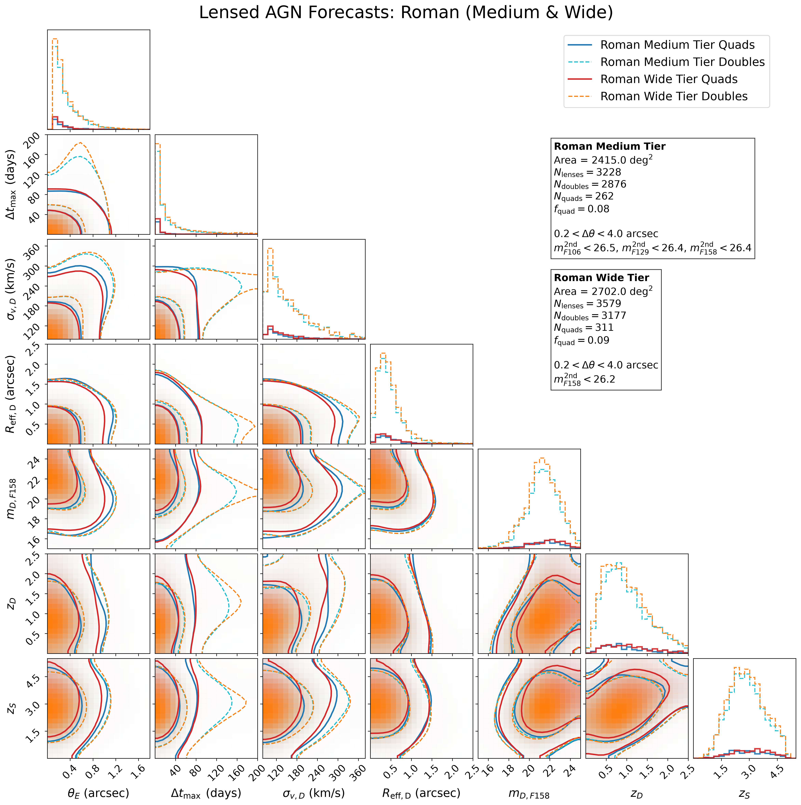
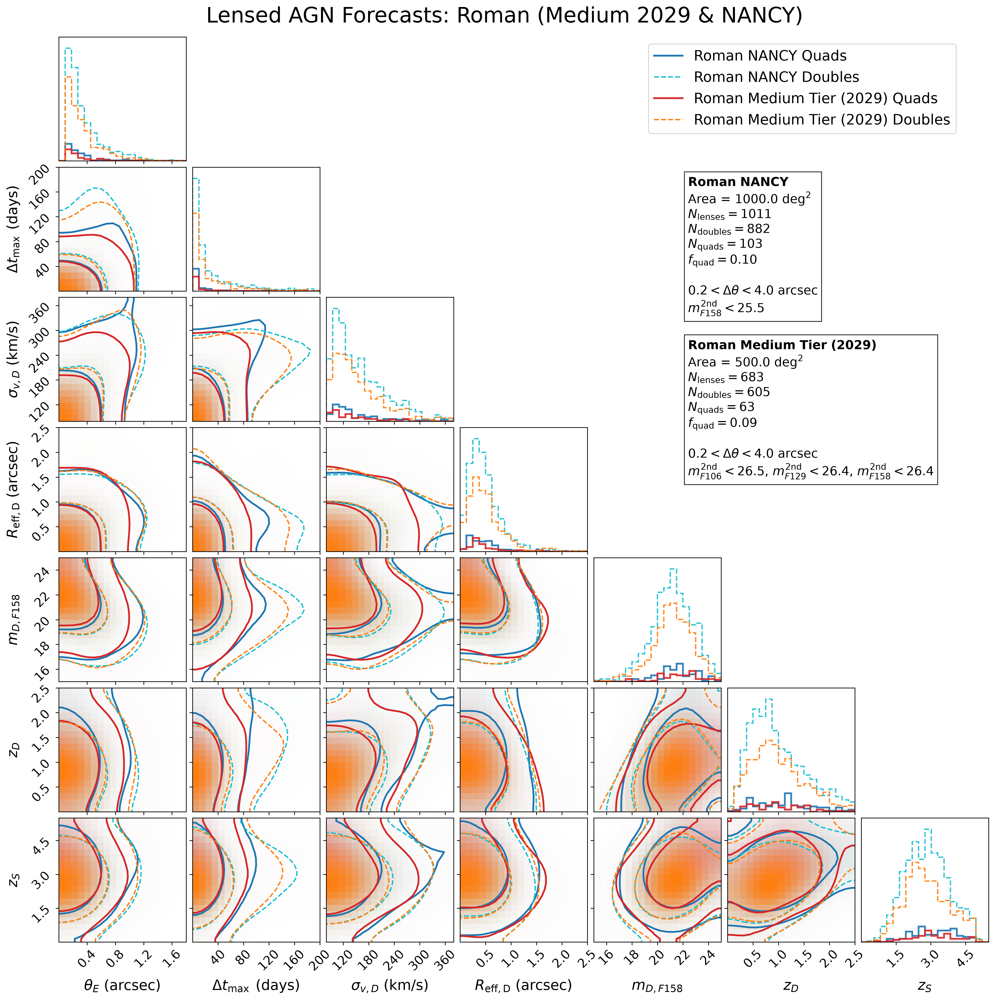
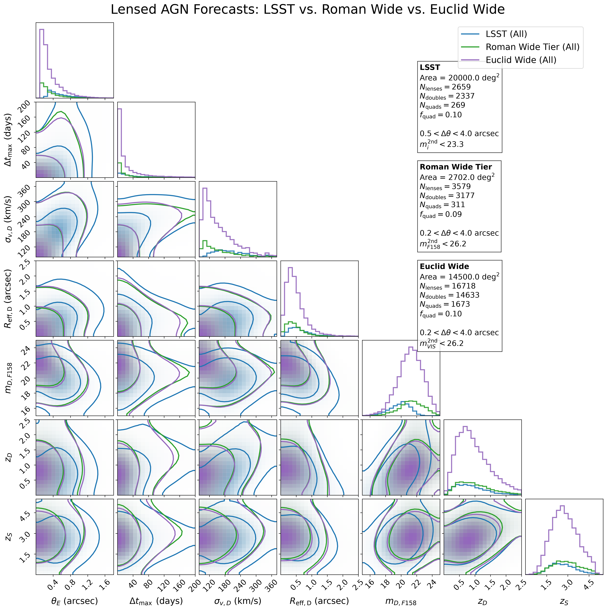
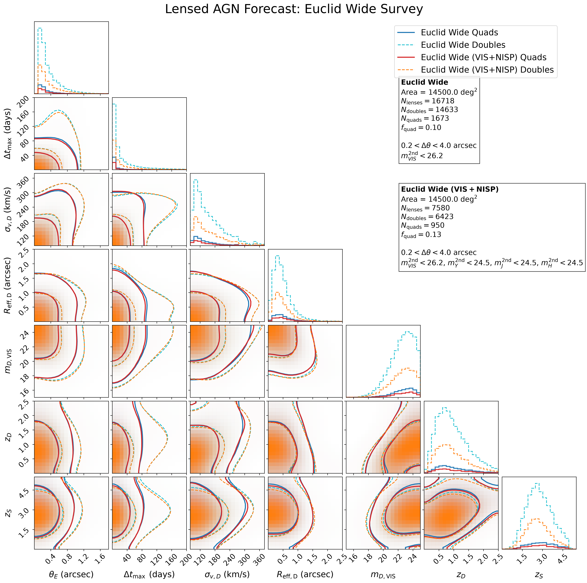

# Lensed AGN Forecasts

This repository uses [`slsim`](https://github.com/LSST-strong-lensing/slsim) to simulate and forecast the yields and physical properties of strongly lensed AGNs (quasars) across upcoming astronomical surveys, including Rubin LSST and the Roman Space Telescope (Medium, Wide, and NANCY tiers).

**Contacts:** Paras Sharma ([github@timedilatesme](https://github.com/timedilatesme), paras.sharma@stonybrook.edu)

## Stats of different samples

| Survey | Sky Area (deg²) | Total Lensed-AGN | Doubles | Triples | Quads | Quints | Quad Fraction | Image Sep Cuts (") | Mag Cuts (2nd Brightest Image) |
| :--- | :--- | :--- | :--- | :--- | :--- | :--- | :--- | :--- | :--- |
| LSST | 20,000 | 2,659 | 2,337 | 51 | 269 | 2 | 10.1% | 0.5 - 4.0 | i &lt; 23.3 |
| Roman Medium Tier | 2,415 | 3,228 | 2,876 | 84 | 262 | 6 | 8.1% | 0.2 - 4.0 | F106 &lt; 26.5, F129 &lt; 26.4, F158 &lt; 26.4 |
| Roman Medium Tier (2029) | 500 | 683 | 605 | 15 | 63 | 0 | 9.2% | 0.2 - 4.0 | F106 &lt; 26.5, F129 &lt; 26.4, F158 &lt; 26.4 |
| Roman Wide Tier | 2,702 | 3,579 | 3,177 | 89 | 311 | 2 | 8.7% | 0.2 - 4.0 | F158 &lt; 26.2 |
| Roman NANCY | 1,000 | 1,011 | 882 | 26 | 103 | 0 | 10.2% | 0.2 - 4.0 | F158 &lt; 25.5 |
| Euclid Wide | 14,500 | 16,718 | 14,633 | 390 | 1,673 | 22 | 10.0% | 0.2 - 4.0 | VIS &lt; 26.2 |
| Euclid Wide (VIS+NISP) | 14,500 | 7,580 | 6,423 | 192 | 950 | 15 | 12.5% | 0.2 - 4.0 | VIS &lt; 26.2, Y &lt; 24.5, J &lt; 24.5, H &lt; 24.5 |

## Images of different samples

## Plots of different samples

